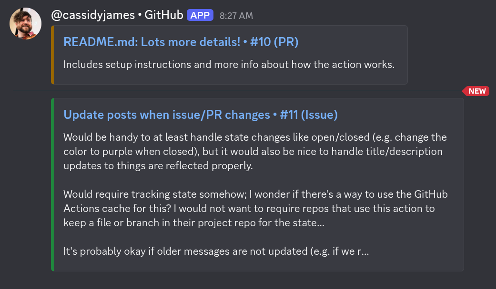

# discord-bot

Simple “bot” powered by GitHub Actions to send low-volume Discord messages when notable things happen on your GitHub repo.



Posts to a Discord channel when:

- An issue is opened
- A pull request is opened (or marked ready for review)
- A release is published
- A repository security advisory is reported or drafted (from a scheduled workflow; see below)

Filters out bots. Uses the GitHub user's username and avatar where possible for nice attribution/integration, especially when contributors use a similar identity across platforms.

> [!NOTE]
> **Why not native GitHub → Discord webhooks?**
> GitHub webhooks don't support the level of granularity we want; they're essentially all-or-nothing for different scopes. Instead, this Action focuses on the events worth sending a message about to a project channel, while still not requiring a extra infra. 

## Setup

**1. Create a webhook integration** in Discord for your project channel. The webhook's name and avatar may be used as a fallback. You can use [github.png](github.png) as the avatar, if you'd like.

**2. Add the webhook URL as a repository secret** for your project repo, named `DISCORD_WEBHOOK_URL`.

**3. Add the workflow** to your project repo, e.g. at `.github/workflows/discord.yml`:

```yaml
name: Discord

on:
  issues:
    types: [opened]
  pull_request_target:
    types: [opened, ready_for_review]
  release:
    types: [published]

permissions: {}

jobs:
  notify:
    runs-on: ubuntu-latest
    steps:
      - uses: roostorg/discord-bot@main
        with:
          webhook-url: ${{ secrets.DISCORD_WEBHOOK_URL }}
```

You can omit any triggers you don't want; e.g. `release` if you only care about issues and PRs.

## Security advisories

GitHub Actions has no event for repository security advisories, so the `security-advisories` action polls for them from a scheduled workflow. Each new advisory in triage or draft is posted once, oldest first. A message contains only the advisory's GHSA ID, state, severity and link, never its title, description, affected code or reporter, so it's suitable for unpublished advisories. Use a webhook for a private channel.

**1. Create an environment** in your project repo, e.g. `security-advisory-notify`, with deployment branches limited to your default branch, and add these environment secrets (not repository secrets, which every branch's workflows can read):

- `SECURITY_DISCORD_WEBHOOK`: the private channel's webhook URL
- `ADVISORY_READ_TOKEN`: a fine-grained token limited to the repo, with "Repository security advisories: Read-only". Its owner must be a repository admin or security manager, or triage advisories aren't listed.

**2. Add the workflow**, e.g. at `.github/workflows/security-advisory-notify.yml`:

```yaml
name: Security advisory notifications

on:
  schedule:
    - cron: '7,22,37,52 * * * *'
  workflow_dispatch:

permissions: {}

concurrency:
  group: security-advisory-notify
  cancel-in-progress: false

jobs:
  notify:
    if: github.ref == 'refs/heads/main'
    environment: security-advisory-notify
    runs-on: ubuntu-latest
    timeout-minutes: 10
    steps:
      - uses: roostorg/discord-bot/security-advisories@main
        with:
          webhook-url: ${{ secrets.SECURITY_DISCORD_WEBHOOK }}
          advisory-read-token: ${{ secrets.ADVISORY_READ_TOKEN }}
```

If either secret is missing, the action skips quietly.

Workflow logs and caches are readable by anyone on a public repo, so the action prints nothing about advisories, and its errors show only HTTP status codes. The advisories already posted are kept in the Actions cache as HMAC-SHA256 hashes of their GHSA IDs keyed by the webhook URL, never the IDs, because pull request runs can read caches saved on the default branch. The state is saved only after posting succeeds, so a failed post is retried on the next run. Changing the webhook URL posts the open advisories again, once.

To post advisories some other way, pass `event: repository_advisory` and a `payload-path` to the main action. The file holds one or more JSON objects shaped like the `repository_advisory` webhook payload, `{"repository_advisory": {...}}`, and each becomes one message.

## Security

This action uses `pull_request_target` so that the workflow running on PRs from forks can use the webhook secret; with plain `pull_request`, workflows running on fork PRs don't get secrets and the post would fail.

`pull_request_target` runs with access to your repo's secrets, so it's only safe because this workflow **never checks out or runs code from the PR** (and PRs always run the workflow from `main` so a malicious PR cannot expose secrets).

> [!CAUTION]
> **Do not add `actions/checkout` or other steps that run PR code to this workflow.** If you need those, put them in a separate workflow.

The workflow needs no GitHub token permissions; it only reads the event payload and posts to Discord.

## Known limitations

- **Posts aren't updated** when they change, e.g. when an issue or PR is closed, since that would require tracking state.

- **GitHub usernames containing "discord" or "clyde"** fall back to the webhook's default name, since Discord doesn't allow those words in webhook names.

## Development

Messages are crafted in [`message.jq`](message.jq) from the GitHub event payload. We target jq 1.6 since GitHub's runners don't always have the latest version.

The `security-advisories` action's tests use only the Python standard library, plus `jq` and `curl`:

```sh
python3 -m unittest discover -s security-advisories
```
